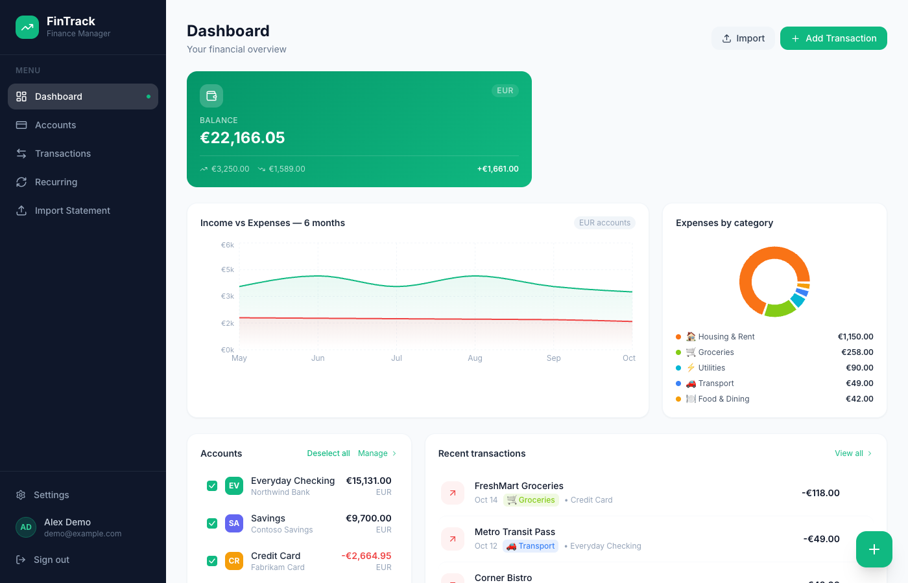

# FinTrack

**Your money is spread across several banks and cards, and no single app shows it all without handing your data to a third party. FinTrack is a personal finance tracker you host yourself.**

More about the project: <https://hmsk.life/tools/fintrack/>

## Features

- **Accounts**: track any number of bank accounts and cards, each with its own currency, balance and color.
- **Transactions**: add income, expenses and transfers between accounts by hand; search, filter by account, month and type, and delete them. Balances update automatically.
- **Dashboard**: total balance, income vs. expenses over the last 6 months, spending by category, recent transactions; pick which accounts to include.
- **Categories and budgets**: default categories on sign-up, your own categories, and a monthly budget per category.
- **Recurring payments**: keep a list of rent, subscriptions and salaries with their next due date, and log them as a transaction with one click.
- **PDF statement import**: upload a bank statement PDF; transactions are extracted with a rule-based parser (no AI service, nothing leaves your server), auto-categorized and de-duplicated. Works with text-based PDFs whose lines contain a date and an amount; scanned images are not supported.
- **CSV export** of your transactions.
- **Optional bank sync (TrueLayer)**: link an account to your bank through TrueLayer open banking and pull the last 90 days of transactions and the balance, on demand or daily. Off unless you configure it.
- Email + password accounts (multiple users per instance, each sees only their own data).

## Screenshots



*Demo data, all names fictional.*

## Quick start

### Option A: Docker Compose (app + PostgreSQL)

```bash
git clone <this repo> fintrack && cd fintrack
cp .env.example .env
# edit .env: set NEXTAUTH_SECRET (openssl rand -base64 32) and NEXTAUTH_URL
docker compose up -d
```

Open <http://localhost:3000> and register your first user. The database schema is created automatically on start; data lives in the `fintrack-db` Docker volume. `DATABASE_URL` in `.env` is ignored here, compose points the app at its own Postgres container (set `POSTGRES_PASSWORD` in `.env` to change the default password).

### Option B: Node.js + any PostgreSQL

Requirements: Node.js 20+ and a PostgreSQL database (local, or a free hosted one such as [Neon](https://neon.tech)).

```bash
npm install
cp .env.example .env      # set DATABASE_URL, NEXTAUTH_SECRET, NEXTAUTH_URL
npm run db:push           # creates the tables
npm run build
npm start                 # http://localhost:3000
```

For development use `npm run dev`. `npm run typecheck` runs the TypeScript checks.

The build uses Next.js `output: 'standalone'`; you can also run `node .next/standalone/server.js` after copying `.next/static` to `.next/standalone/.next/static`.

## Configuration

| Variable | Required | Default | Description |
|---|---|---|---|
| `DATABASE_URL` | yes | | PostgreSQL connection string. Hosted providers usually need `?sslmode=require`. |
| `NEXTAUTH_SECRET` | yes | | Random secret that signs sessions. `openssl rand -base64 32` |
| `NEXTAUTH_URL` | yes | `http://localhost:3000` | Public URL of the app, no trailing slash. |
| `TRUELAYER_CLIENT_ID` | no | | Enables bank sync (together with the secret). |
| `TRUELAYER_CLIENT_SECRET` | no | | Enables bank sync (together with the ID). |
| `TRUELAYER_ENV` | no | `sandbox` | `sandbox` (test banks) or `live` (real banks). |
| `TRUELAYER_PROVIDERS` | no | sandbox: `uk-cs-mock uk-ob-all uk-oauth-all`, live: `uk-ob-all uk-oauth-all` | Banks offered in the TrueLayer picker, e.g. add `de-ob-all de-oauth-all`. |
| `CRON_SECRET` | no | | Enables `GET /api/cron/sync-banks` (daily sync of all linked accounts), protected by `Authorization: Bearer <CRON_SECRET>`. |
| `POSTGRES_PASSWORD` | no (compose only) | `fintrack` | Password of the bundled Postgres container. |
| `APP_PORT` | no (compose only) | `3000` | Host port for the app. |
| `SKIP_DB_PUSH` | no (Docker only) | `false` | Set `true` to skip the automatic `prisma db push` on container start. |

### Optional: bank sync with TrueLayer

Without TrueLayer keys the app works fully (manual entry, PDF import, CSV export) and the "Connect Bank" buttons are hidden.

1. Create an app in the [TrueLayer console](https://console.truelayer.com) and add `<NEXTAUTH_URL>/api/banking/callback` as an allowed redirect URI.
2. Set `TRUELAYER_CLIENT_ID` and `TRUELAYER_CLIENT_SECRET`. Start with `TRUELAYER_ENV=sandbox` (mock bank `uk-cs-mock`), switch to `live` with live credentials when ready.
3. On the Accounts page use **Connect Bank** on an account, then **Sync now** whenever you like.
4. For a daily sync, set `CRON_SECRET` and call the endpoint from any scheduler, e.g. a crontab line:
   ```
   0 6 * * * curl -fsS -H "Authorization: Bearer YOUR_CRON_SECRET" https://your-host/api/cron/sync-banks
   ```

Bank access tokens are stored in your database; protect it accordingly.

## Privacy

FinTrack is self-hosted: your financial data stays in your own database on your own server. The app itself sends no telemetry and has no third-party analytics. The only outside calls are Google Fonts for the UI font and, if you enable it, TrueLayer for bank sync.

## Tech stack

Next.js 15 (App Router), React 19, TypeScript, Tailwind CSS, Prisma + PostgreSQL, NextAuth (credentials), Recharts, pdf-parse.

## License

[MIT](LICENSE) © 2026 Hafiz Muhammad Sharoz Khalid
